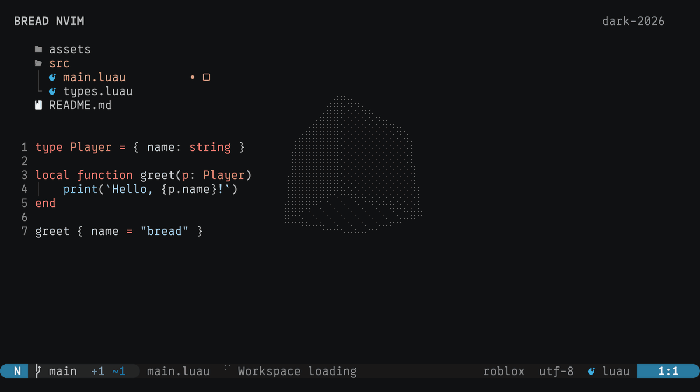

# 🍞 面包 NVIM (Nightly)

面包人专用 nvim 配置文件（大概



## ✨ 特性

- **Core**: Neovim 0.12+（已验证 0.13 Nightly）
- **AI**: Codeium (Free & Fast)
- **LSP**: Mason + Blink.cmp 
- **UI**: VS Code Dark 2026（透明背景）+ Lualine + Smear Cursor
- **Debug**: DAP (C++/Python)
- **Bootstrap**: Windows / Linux 系统依赖引导，自动安装语言工具及语法解析器

主题使用 [dark-2026.nvim](https://github.com/boonyarit-iamsaard/dark-2026.nvim)。`lua/config/theme.lua` 中的 `transparent = true` 让编辑区和文件树透出终端背景，浮窗和补全菜单保留底色；改为 `false` 可恢复主题实色背景。窗口是否半透明、是否显示桌面，由终端自身的透明度设置决定。

## 🚀 快速安装

入口要求：**Git、Neovim 0.12+（含 `vim.pack`）和可访问 GitHub 的网络**。目前保留原配置的 Nightly 版本要求，不支持直接使用 0.11。

Windows（PowerShell）：

```powershell
git clone https://github.com/Xorice/nvim-config "$env:LOCALAPPDATA\nvim"
nvim
```

Linux：

```bash
git clone https://github.com/Xorice/nvim-config "${XDG_CONFIG_HOME:-$HOME/.config}/nvim"
nvim
```

已有配置仓库直接 `git pull` 后打开 `nvim`。

首次启动会检查基础工具。缺少时，自动打开安装终端：Windows 使用系统自带的 **WinGet**；Linux 支持 **apt / dnf / pacman**，需要时在终端输入 sudo 密码。安装完成后重新打开 Neovim，继续自动下载插件、LSP、调试器、Tree-sitter CLI 和解析器。等待 `:Mason` 中的安装完成即可；以后启动会跳过已经安装的工具。系统安装只自动尝试一次，失败后修复原因并运行 `:BootstrapDeps` 重试。

自动安装范围：

| 层级 | 内容 |
|------|------|
| 系统工具 | Git / gzip、curl、tar、解压工具、Node.js / npm、Python / venv、C/C++ 编译器、ripgrep、fd |
| 语言工具 | lua-language-server、clangd、pyright、luau-lsp、codelldb、debugpy、Tree-sitter CLI |
| 语法解析器 | Lua、Luau、C、C++、Python、Markdown、Vim、vimdoc、query |

已有工具会优先复用。Windows 自动发现 Git 自带的 gzip、7-Zip、WinGet 安装的 WinLibs，以及传统安装器 / Python Install Manager 安装的标准 CPython，避免 MSYS Python 的 venv 路径差异；启动时不运行 Python Launcher。Lua 文件运行优先使用 lua/luajit，没有独立解释器时使用 Neovim 自带 LuaJIT（`nvim --clean -l`）。

普通启动只验证基础工具是否可用，不运行 Python 的 venv/ensurepip 深度检查；深度检查由 `:checkhealth bread` 和系统安装脚本执行。已验证的工具路径保存在 `stdpath('state')/bread-system-tools.json`，只有固定的一组基础工具；PATH / PATHEXT 变化或缓存中的工具失效时重新查找。工具和解析器齐全时跳过 Mason registry 刷新及解析器安装，可离线启动。

调试器在首次使用调试快捷键 / DAP 命令时加载，文件树和 Telescope 在首次使用时加载，Markdown 预览在打开 Markdown 时加载；`nvim .` 仍直接打开文件树。语言服务在打开对应代码文件后初始化，普通 Lua 文件不会提前加载 Roblox API 下载组件。注释使用 Neovim 内置的 `gc` / `gcc`，LÖVE 运行统一由受管理的 runner 负责。

**仍需自行设置的可选功能**：终端字体选择 Nerd Font；AI 首次使用运行 `:Codeium Auth` 登录；LÖVE 游戏引擎和 Rojo 按项目需要安装并加入 PATH。没有 Rojo 时保留 Luau 语言服务，关闭自动生成 sourcemap。项目自身的第三方库与构建环境仍由项目管理。

### 检查和修复

```vim
:checkhealth bread
:BootstrapDeps
:InstallTools
:Mason
:MasonLog
```

`BootstrapDeps` 补系统工具；`InstallTools` 补语言工具和解析器。网络或权限错误会显示在安装终端 / Mason 日志中，不会标记为安装成功。

`:UpdateTools` 主动更新 Mason 管理的语言服务和调试器；完成后重启 Neovim。Luau LSP 至少使用 1.70.1，旧版本会在正常工具安装流程中升级，不会每次启动都追踪最新版。

也可以先在外部终端执行安装脚本（不需要启动 Neovim）：

```powershell
powershell -NoProfile -ExecutionPolicy Bypass -File scripts/bootstrap.ps1
# 仅查看缺失依赖，不安装
powershell -NoProfile -ExecutionPolicy Bypass -File scripts/bootstrap.ps1 -Check
```

```bash
bash scripts/bootstrap.sh
bash scripts/bootstrap.sh --check
```

插件版本由仓库内的 `nvim-pack-lock.json` 固定。主动更新插件使用 `:lua vim.pack.update()`，审阅并保存更新窗口；随后执行 `:TSUpdate` 更新解析器，并一并提交锁文件。

### 无界面验证

已有插件安装完成后，可以禁用后台下载运行冒烟检查（启动、状态栏、调试配置，以及带空格和 `&` 路径的 C/C++/Python/Lua 编译运行）。Windows 无界面 ConPTY 的输出直接写到父终端，因此测试通过管道捕获同一组真实进程。

```powershell
$env:NVIM_NO_INSTALL = '1'
$env:NVIM_NO_BOOTSTRAP = '1'
$env:NVIM_NO_AI = '1'
nvim --headless '+luafile scripts/smoke.lua'
# 验证项目识别、真实 Lua/Luau API 提示、sourcemap 和运行进程清理
nvim --headless '+luafile scripts/project-smoke.lua'
Remove-Item Env:NVIM_NO_INSTALL, Env:NVIM_NO_BOOTSTRAP, Env:NVIM_NO_AI
```

```bash
NVIM_NO_INSTALL=1 NVIM_NO_BOOTSTRAP=1 NVIM_NO_AI=1 nvim --headless '+luafile scripts/smoke.lua'
```

这三个环境变量分别禁用语言工具自动下载、系统依赖自动安装和 AI；正常使用无需设置。Windows 已实际运行验证；Linux 安装脚本仍需要在对应发行版上验证。

## ⌨️ 按键绑定
 
**Leader**: `,`
 
### 文件 & 搜索
 
| 按键 | 功能 |
|------|------|
| `,e` | 切换文件树 (Neo-tree) |
| `Ctrl+P` | 模糊查找文件 (Telescope) |
| `,fg` | 项目全文搜索 |
| `,fw` | 在项目中搜索光标处的单词 |
| `,gs` | 浮动显示 Git 状态 |
| `,m` | 切换 Markdown 预览 |
 
### 编译 & 调试
 
| 按键 | 功能 |
|------|------|
| `,rc` | 普通语言编译/运行当前文件；LÖVE 运行整个项目 |
| `,rs` | 停止当前运行任务 |
| `,ro` | 重新显示运行输出 |
| `,r` | DAP 开始 / 继续调试 |
| `,b` | 切换断点 |
| `,di` | Step Into |
| `,do` | Step Over |
| `,du` | 切换调试 UI |
| `,dq` | 终止调试 |
 
### 编辑
 
| 按键 | 功能 |
|------|------|
| `Alt+]` | 增加缩进 |
| `Alt+[` | 减少缩进 |
| `Alt+J` | 当前行下移 |
| `Alt+K` | 当前行上移 |
| `Alt+左/右` | 缩小 / 增大当前窗口宽度，每次 3 列 |
| `Alt+上/下` | 缩小 / 增大当前窗口高度，每次 3 行 |
| `Ctrl+S` | 保存 |
| `Shift+方向键` | 进入 / 扩展 Visual 选区 |
| `Ctrl+H/L` | 按单词跳转 |
| `Ctrl+/` | 注释 / 取消注释 |
| `,cf` | 使用当前语言服务手动格式化；不自动在保存时格式化 |
| `Tab` | 接受补全；没有候选时跳到下一个 snippet 占位或正常缩进 |
| `Shift+Tab` | 返回上一个 snippet 占位 |
| `Enter` | 正常换行，不确认补全 |
| `K` | 查看光标处的函数 / 字段说明；再次按下进入说明窗口 |
| `Ctrl+D` / `Ctrl+U` | 说明弹窗打开时向下 / 向上滚动说明，否则滚动代码 |
 
### 折叠

代码缩进层级显示低对比度细线，光标所在代码块的引导线略亮；引导线由 Snacks indent 提供，关闭动画。搜索与文件树仍使用 Telescope 和 Neo-tree。
 
| 按键 | 功能 |
|------|------|
| `zR` | 展开所有折叠 |
| `zM` | 折叠所有 |
 
### AI 补全 (Codeium)
 
| 按键 | 功能 |
|------|------|
| `Ctrl+F` | 接受当前建议 |
| `Alt+n` | 下一条建议 |
| `Alt+p` | 上一条建议 |
 
### Love2D
 
| 按键 | 功能 |
|------|------|
| `,lr` | 运行 LÖVE 项目 |

重复运行会先停止上一次任务，输出保留在受管理的终端中；终端输入模式下按两次 `Esc` 返回普通模式。关闭输出窗口不会停止程序，使用 `,rs` 停止，`,ro` 重新打开输出。退出 Neovim 时停止当前任务。普通 Lua 和 LÖVE 运行不创建 `__debug__`，该目录仅用于 C/C++ 编译。Python 运行和调试共用解释器选择：激活的虚拟环境 / Conda 环境优先，然后从当前文件向上寻找项目 `.venv`，最后使用 PATH 中的 Python。

持久撤销默认启用，历史保存在 Neovim 的 state 目录，重新打开文件后仍可撤销。搜索以 Lua 项目根目录或 Git 根目录为范围，避免从嵌套脚本目录启动时漏搜项目文件。

外部 agent 保存文件后，当前 Nightly 通过原生文件监听自动重载已打开且没有未保存修改的 buffer，无需切换窗口或安装插件。若 Neovim 内也有未保存修改，会保留编辑内容并提示冲突；此时先比较两边内容，确认后再选择保存或重新读取。必要时可用 `:checktime` 手动检查外部改动。

## Lua / LÖVE / Roblox 项目环境

状态栏显示当前 Lua 文件使用的 `lua`、`love`、`roblox`、`luau` 或 `nvim` 环境。`:LuaProjectInfo` 查看项目根目录、LÖVE 入口和 Rojo 配置路径。按项目使用语言服务，不把 `vim`、`love`、Roblox 全局变量混在同一环境里。

| 项目 | 识别依据 | 提示与运行 |
|------|----------|------------|
| Roblox / Rojo | `*.project.json`，优先 `default.project.json`；多个非默认配置时选择一次 | `.lua`、`.luau` 均使用 Luau 高亮和 Roblox 语言服务；在 Studio 中运行 |
| 独立 Luau | `.luaurc` 或 `.luau` 文件 | 使用不加载 Roblox API 的 Luau 语言服务 |
| LÖVE | `.luarc.json/jsonc` 中的 LÖVE 设置；或 `main.lua/conf.lua` 中的 LÖVE 回调 | LuaJIT + LÖVE 11.5 类型库；从根目录或 `src/` 中的 `main.lua` 启动 |
| 普通 Lua | `.luarc.json/jsonc` 或普通 `.lua` 文件 | LuaLS；运行当前脚本 |
| Neovim 配置 | 当前 Neovim 配置目录 | LuaJIT + Neovim 类型定义 |

最近的明确项目配置优先于源码推断；例如 Rojo 仓库的 `tools/` 内有自己的 `.luarc.json` 时，其中的工具脚本仍按普通 Lua 处理。只叫 `main.lua` 并不会被判定为 LÖVE。已有项目配置优先，Luau 不自动强制 `strict`，新版类型求解器默认启用。

项目识别结果随 buffer 缓存，普通文件切换不反复扫描目录；删除 buffer 时释放。保存标准项目配置、修改 `main.lua/conf.lua` 的环境特征、切换目录或重新获得焦点时按需重新识别，类型变化会同步重启对应语言服务，让状态栏与实际 API 提示保持一致。打开文件不会创建项目配置或缓存文件。

新项目由你主动初始化，打开文件不会生成配置：

```vim
:LuaProjectInit love
:LuaProjectInit lua
:LuaProjectInit luau
:LuaProjectInit roblox
```

`love/lua` 创建 `.luarc.json`，`luau/roblox` 创建采用 `nonstrict` 的 `.luaurc`；已有配置不会覆盖。`roblox` 要求已有 Rojo 项目，编辑器不代建场景结构。LÖVE 初始化只写可移植的 LuaJIT 和 `love.filesystem.load` 设置，不含本机路径。LÖVE 类型库作为固定版本插件安装在 Neovim 数据目录，按项目加载。

无法识别或需要临时纠正时使用 `:LuaProjectUse love|lua|luau|roblox`，`:LuaProjectUse auto` 恢复自动识别。这些选择仅在当前会话有效，没有额外的项目登记文件。

Roblox API 定义和文档由 `luau-lsp.nvim` 下载、共享并更新缓存。Rojo sourcemap 在 Roblox 语言服务连接后自动维护，以项目根目录运行，因此兼容 Rokit 等项目工具链。启动时先保留 Roblox API 提示，后台生成并校验首份映射后才启用实例路径提示，避免读取尚未生成的文件。缓存映射内容发生变化时会主动刷新实例提示，支持新建、删除和重命名模块。每个项目复用一个监听进程，文件写到 `stdpath('cache')/bread/sourcemaps/`；关闭该项目最后一个脚本或退出 Neovim 时停止监听、释放文件监听及防抖计时器，并删除本次映射。监听错误输出仅保留最后 8 KiB；30 秒内未生成有效映射会停止监听并提示原因。强制终止后留下的映射会在下次启动时按所属进程是否存在清理。

Rojo 的 `serve/build` 仍在外部终端操作，编辑器不启动 Studio 桥接。没有安装项目的 Rojo 工具时仍有 Roblox API 提示，实例树和项目路径提示需要可用的 sourcemap。验证 `project-smoke.lua` 需要 LÖVE 和项目可用的 Rojo（测试项目使用 Rokit 的 `rojo-rbx/rojo@7.7.1`）。
 
## 🔧 支持的语言
 
| 语言 | LSP | 调试 | 编译运行 |
|------|-----|------| -------|
| C / C++ | clangd | codelldb ✅ | ✅  |
| Python | pyright | debugpy ✅ | ✅  |
| Lua | lua_ls | — | ✅  |
| Luau | luau-lsp | — | ❌ |
